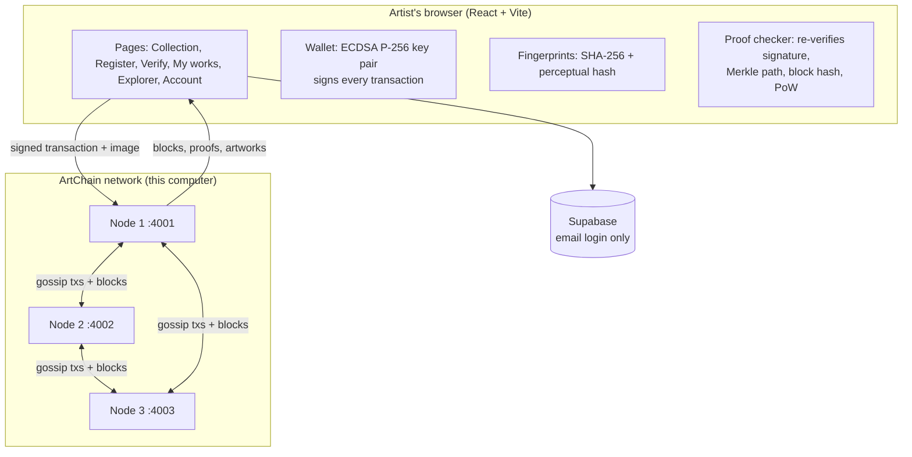
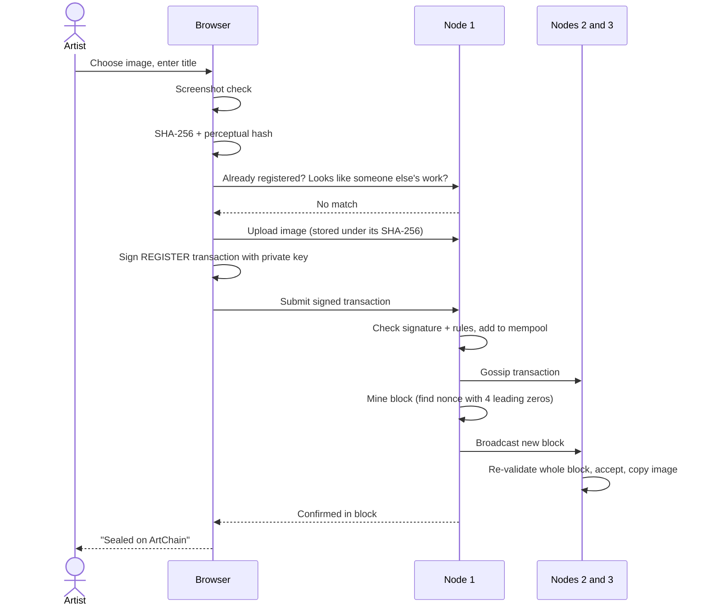
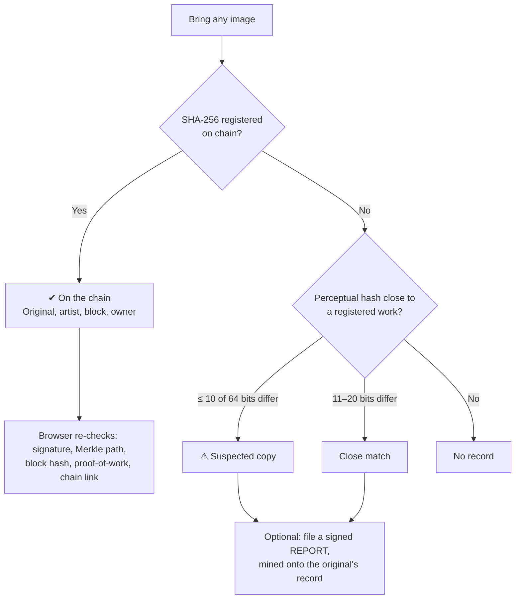
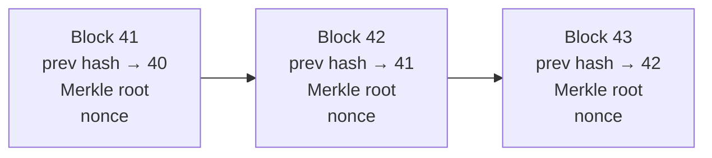

# ArtProvenance on ArtChain

**Prove a digital artwork is yours, and let anyone check it.**

ArtProvenance fingerprints each artwork, has the artist sign it with their own key, and records it on **ArtChain**, a proof-of-work blockchain built from scratch for this project. ArtChain runs as three nodes on one computer at no cost: no Ethereum, no cryptocurrency, no fees.

Anyone can later bring any image and find out whether it is the **registered original**, a **likely copy**, or **unknown**, and re-check the proof in their own browser.

---

## Contents

1. [What it does](#what-it-does)
2. [Architecture](#architecture)
3. [Workflows](#workflows)
4. [How the blockchain works](#how-the-blockchain-works)
5. [Why records can't be faked](#why-records-cant-be-faked)
6. [Project structure](#project-structure)
7. [Setup and run](#setup-and-run)
8. [Demo script](#demo-script)
9. [Tests](#tests)
10. [Node API](#node-api)
11. [Limits](#limits)

---

## What it does

| Feature | What happens |
|---|---|
| **Register a work** | The browser fingerprints the image, signs a transaction with the artist's private key, and the network mines it into a block |
| **Copy detection** | Exact duplicates and visually near-identical copies of another artist's work are rejected by every node |
| **Verify any image** | Exact match on chain, close match, or no record, with a proof the browser re-checks itself |
| **Transfer ownership** | The current owner signs a transfer; the full ownership history stays on chain |
| **Report a forgery** | Anyone can file a signed report linking a copy to the original, permanently |
| **Block explorer** | Blocks, transactions, addresses, Merkle trees, mempool, nodes, full-chain validation and a live tamper test |
| **Wallet** | Key pair created in the browser; encrypted backup and restore |

---

## Architecture



Each node keeps a **full copy of the chain**, **validates every block**, **mines new blocks**, and **stores images** by their SHA-256 hash (copied between nodes).

| Data | Where it lives | Why |
|---|---|---|
| Registrations, owners, transfers, reports, artist names | ArtChain blocks (every node) | Permanent, signed, checkable by anyone |
| Image files | Each node's file store, named by SHA-256 | Too big for blocks; the name proves the bytes are unaltered |
| Private key | Artist's browser (+ encrypted backup file) | Only the artist can sign for their works |
| Email and password | Supabase (or a local fallback) | Ordinary login; nothing about artworks |

---

## Workflows

### 1. Register an artwork



The seven steps the user sees on screen:

1. Rule out screenshots and resized copies
2. Fingerprint the file (SHA-256 and perceptual hash)
3. Ask the chain whether this work, or one like it, exists
4. Store the image on the node, addressed by its hash
5. Sign a REGISTER transaction with the private key
6. Broadcast it to the network's mempool
7. Wait for a node to mine it into a block

### 2. Verify an image



### 3. Transfer ownership

1. The owner opens **My works** and chooses **Transfer ownership**.
2. They pick another artist (or paste an address) and sign a `TRANSFER` transaction.
3. Every node checks the signer is the current owner, then mines it.
4. The certificate's provenance timeline shows every hand-off.

### 4. Sign-up and wallet

1. The artist signs up with email and password (Supabase).
2. The browser creates an ECDSA P-256 key pair; the private key never leaves the browser.
3. The artist's name is published on chain as an `IDENTITY` transaction.
4. **Account → Download encrypted backup** saves the key (PBKDF2 + AES-256-GCM) to restore on another device.

---

## How the blockchain works

### Block structure



| Header field | Meaning |
|---|---|
| `index` | Height of the block |
| `timestamp` | When it was mined |
| `previousHash` | Hash of the block before; links the chain |
| `merkleRoot` | One hash summarising every transaction in the block |
| `difficulty` | Leading zeros the hash must have (default 4) |
| `nonce` | Number the miner changed until the hash had enough zeros |
| `miner` | Address of the node that mined it |

`hash = SHA-256(header)`. Change any field and the hash changes.

### Transactions

Every transaction is `{ id, type, from, publicKey, payload, timestamp, signature }`, where `id = SHA-256(contents)` and `signature = ECDSA(id)` with the sender's private key.

| Type | Records | Rule every node enforces |
|---|---|---|
| `IDENTITY` | Artist's display name | 1–60 characters |
| `REGISTER` | SHA-256, perceptual hash, title, description | Not already registered; not within 10 of 64 bits of another artist's work |
| `TRANSFER` | New owner's address | Signer must be the current owner |
| `REPORT` | Suspected copy → original | Original exists; one report per person per copy |

These rules are the chain's built-in program (its "smart contract"): a block containing a transaction that breaks one is rejected by every node.

### Consensus

- Nodes **gossip** new transactions and blocks to each other.
- A node mines a block a second or two after transactions arrive.
- Every node **re-validates** each block: links, hash, proof-of-work, Merkle root, every signature, every rule.
- If two chains compete, every node keeps the **valid chain with the most total work** (ties go to the lower tip hash), so all nodes agree.
- A node that was offline catches up from its peers when it restarts.

### Blockchain concepts used

| Concept | Where |
|---|---|
| SHA-256 hashing, canonical JSON | `server/chain/crypto.js` |
| ECDSA P-256 signatures, addresses | `server/chain/crypto.js`, `src/lib/wallet.ts` |
| Merkle tree and proofs | `server/chain/merkle.js` |
| Transactions | `server/chain/transaction.js` |
| On-chain rules and world state | `server/chain/state.js` |
| Blocks, genesis, proof-of-work mining | `server/chain/block.js` |
| Mempool, validation, fork choice, persistence | `server/chain/blockchain.js` |
| Peer-to-peer gossip and sync | `server/chain/p2p.js` |
| Content-addressed image storage | `server/chain/filestore.js` |
| Light-client verification in the browser | `src/lib/artchain.ts` |

---

## Why records can't be faked

| Attempt | What catches it |
|---|---|
| Edit a title in an old block | The transaction id no longer matches its contents |
| Also recompute the id, Merkle root and block hash | The new hash has no proof-of-work |
| Also re-mine that block | The next block's `previousHash` breaks, and the artist's signature fails |
| Sign as someone else | Impossible without their private key |
| Transfer a work you don't own | Rejected by the `TRANSFER` rule on every node |
| Resubmit the same signed transaction | Its id is already on chain (replay protection) |
| Edit `chain.json` on disk | The node re-validates at start-up, quarantines the file and resyncs |

**Explorer → Try to rewrite history** runs the first three attacks live and shows each one rejected.

---

## Project structure

```
project/
├── src/                        Website (React + TypeScript + Tailwind)
│   ├── pages/                  Dashboard, Explorer, My works, Account, Login, Sign-up
│   ├── components/             Register, Verify, Gallery, Certificate, Transfer, ...
│   ├── contexts/               Auth (Supabase) and Wallet
│   └── lib/
│       ├── artchain.ts         Node client + in-browser proof checks
│       ├── wallet.ts           Key pair, signing, encrypted backup
│       ├── hashing.ts          SHA-256, file checks
│       └── perceptual-hash.ts  Visual fingerprint, screenshot check
├── server/                     ArtChain node (Node.js + Express)
│   ├── chain/                  Blockchain core (see table above)
│   ├── server.js               One node: REST API + peer protocol
│   ├── network.js              Starts 3 nodes in one terminal
│   ├── test/                   12 automated tests
│   └── data/                   Chain, mempool, images, node key (created at run time)
├── supabase/setup.sql          Only SQL needed (profiles table + trigger)
└── BLOCKCHAIN.md               Detailed blockchain notes
```

---

## Setup and run

**Needs:** Node.js 20 or later.

### 1. Install (first time only)

```bash
cd project/server
npm install
cd ..
npm install
```

### 2. Configure `.env` (in `project/`)

```
VITE_SUPABASE_URL=https://<your-project>.supabase.co
VITE_SUPABASE_ANON_KEY=<anon / publishable key>
VITE_NODE_URL=http://localhost:4001
```

Use the **anon (public)** key, never the secret key. To skip Supabase entirely, leave `VITE_SUPABASE_URL=your_supabase_project_url`; the app then uses a local login stored in the browser.

### 3. Set up Supabase (if using it)

In the Supabase dashboard, open **SQL Editor**, paste `supabase/setup.sql`, and click **Run**. For a demo, also switch off **Confirm email** in the Email sign-in settings.

### 4. Start

```bash
# Terminal 1: three ArtChain nodes
cd project/server
npm start

# Terminal 2: the website
cd project
npm run dev
```

Open **http://localhost:5174** (use `localhost`, not a network address; browsers only allow the wallet's encryption there).

To start a brand-new chain: stop the nodes and delete `server/data`.

---

## Demo script

1. `npm start`: three nodes start with the same genesis hash.
2. Sign up as **Artist A**; their name appears on chain.
3. **Register a work**: the seven steps tick, and the node logs show `mined #n` and `accepted block #n`.
4. Open the certificate and press **Verify this record in my browser**: every check passes.
5. In another browser, sign up as **Artist B** and try to register a resized copy: it is refused.
6. **Verify** the copy, then **Report this copy on ArtChain**: the report is mined onto the original.
7. Artist A **transfers** a work to B; the provenance timeline updates.
8. **Explorer → Run all checks**, then **Try to rewrite history**: all three forgeries fail.
9. Stop one node, register something, restart it: it catches up.

---

## Tests

```bash
cd project/server
npm test
```

| Suite | Covers | Result |
|---|---|---|
| Chain tests (12) | Merkle proofs, signatures, registry rules, replay, tampering, missing proof-of-work, fork choice, tampered file on disk, live 3-node network | 12 / 12 pass |
| API stress (40 checks) | Malformed and forged transactions, oversized files, 20 concurrent transactions, duplicate-registration race | 40 / 40 pass |
| Browser end-to-end (46 checks) | Sign-up/login, every feature, two users, wallet backup/restore, mobile layout | 46 / 46 pass |

---

## Node API

| Method | Path | Purpose |
|---|---|---|
| GET | `/status` | Height, difficulty, mempool, mining stats, peers |
| GET | `/blocks`, `/blocks/:id` | Block list; full block with Merkle levels |
| POST | `/tx` | Submit a signed transaction |
| GET | `/tx/:id`, `/tx/:id/proof` | Transaction status; Merkle proof |
| GET | `/artworks`, `/artworks/:hash` | Registry with provenance |
| GET | `/similar/:phash` | Nearest visual matches |
| GET | `/accounts/:address` | An address's works and activity |
| GET | `/chain/validate` | Full re-validation report |
| POST | `/chain/tamper-demo` | Forge copies of the chain and validate them |
| POST/GET | `/files`, `/files/:hash` | Content-addressed image store |
| — | `/p2p/*` | Node-to-node protocol |

---

## Limits

- All three nodes run on one computer, so this **demonstrates** consensus rather than providing real decentralisation.
- Difficulty 4 makes mining fast for a demo; raise it with `--difficulty` for costlier re-mining.
- A wallet lives in one browser; use the encrypted backup to move it.
- Perceptual hashing catches resized and recompressed copies, not heavy edits or crops.
- Running publicly would need a persistent server for the nodes, HTTPS for the site, and upload limits.

---

**Tech stack:** React 18, TypeScript, Vite, Tailwind CSS, Node.js, Express, WebCrypto, Supabase Auth.
